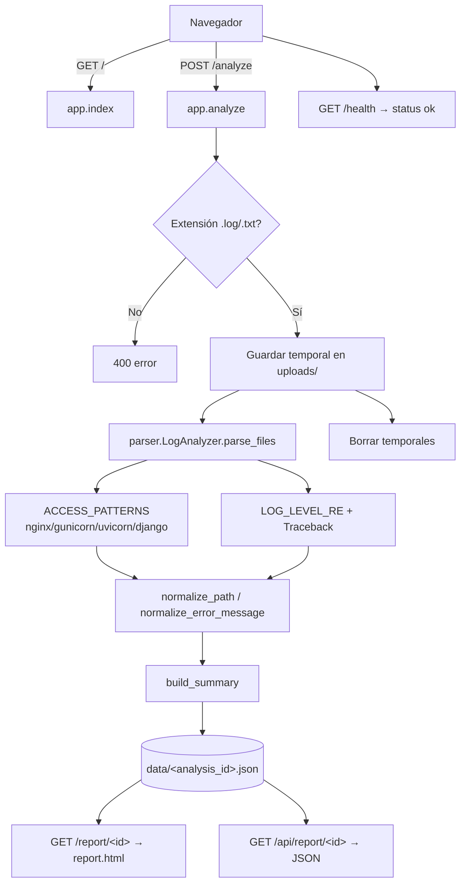

# py-guard — Log Analyzer MVP

MVP web para cargar y analizar logs de aplicaciones Python Flask o Django. Entrega un panel simple con IPs que más acceden, rutas más visitadas, métodos HTTP, códigos HTTP, errores más repetidos, actividad por hora, matrices IP/status y ruta/status, y eventos recientes.

[](https://python.org)
[](https://flask.palletsprojects.com)
[](LICENSE)
[](https://github.com/bi0punk/py-guard/actions)

## Contenido

- [Características](#características)
- [Arquitectura](#arquitectura)
- [Stack](#stack)
- [Estructura del repositorio](#estructura-del-repositorio)
- [Instalación](#instalación)
- [Uso](#uso)
- [Configuración](#configuración)
- [Tests / CI](#tests--ci)
- [Roadmap](#roadmap)
- [Licencia](#licencia)

## Características

- Carga de archivos `.log` / `.txt` (múltiples a la vez) hasta 100 MB por request.
- Parser streaming línea a línea (no carga todo en memoria de golpe).
- Soporta formato common/combined (nginx, gunicorn), acceso tipo uvicorn y logs de desarrollo de Django.
- Agrupación de stacktraces multilínea.
- Normalización de rutas (`/api/orders/123` → `/api/orders/<num>`) y de mensajes de error.
- Panel con top IPs, rutas, métodos, códigos HTTP, errores y rutas con errores.
- Matrices IP vs status y ruta vs status, actividad por hora y eventos recientes.
- Persistencia del análisis en JSON y endpoint API `/api/report/<id>`.
- Endpoint de salud `/health`.
- Dockerfile con usuario no root.

## Arquitectura



## Stack

| Componente | Tecnología |
|---|---|
| Lenguaje | Python 3.12 |
| Framework web | Flask 3.1 |
| Servidor WSGI / utilidades | Werkzeug 3.1.3 |
| Frontend | Jinja2 + CSS propio (sin charts JS) |
| Persistencia | Archivos JSON en `data/` |
| Tests / lint | pytest, ruff |
| Empaquetado | Docker (python:3.12-slim) |

## Estructura del repositorio

```
py-guard/
├── app.py                      # Rutas Flask (index, analyze, report, api, health)
├── parser.py                   # LogAnalyzer, normalización y resumen
├── requirements.txt
├── Dockerfile
├── .dockerignore
├── LICENSE
├── static/
│   └── styles.css
├── templates/
│   ├── base.html
│   ├── index.html
│   ├── report.html
│   └── 404.html
├── tests/
│   ├── conftest.py
│   ├── test_app.py
│   └── test_parser.py
├── uploads/   # generada en tiempo de ejecución (gitignoreada)
└── data/      # reportes JSON generados
```

## Instalación

### Opción A: Python directo

```bash
python3 -m venv .venv
source .venv/bin/activate
pip install -r requirements.txt
python app.py
```

Abrir `http://127.0.0.1:8000`.

### Opción B: Docker

```bash
docker build -t log-analyzer-mvp .
docker run --rm -p 8000:8000 log-analyzer-mvp
```

### Opción C: desarrollo con uv

```bash
uv pip install --system ".[dev]"
uv run pytest -q
```

## Uso

Sube un archivo de logs a través de la interfaz y serás redirigido al reporte. Rutas disponibles:

| Método | Ruta | Descripción |
|---|---|---|
| GET | `/` | Formulario de carga y reportes recientes |
| POST | `/analyze` | Procesa los archivos subidos |
| GET | `/report/<analysis_id>` | Panel HTML del análisis |
| GET | `/api/report/<analysis_id>` | Resumen del análisis en JSON |
| GET | `/health` | Estado del servicio (`{"status":"ok"}`) |

## Configuración

Variables de entorno (ver `.env.example`):

| Variable | Default | Descripción |
|---|---|---|
| `HOST` | `0.0.0.0` | Host de escucha Flask |
| `PORT` | `8000` | Puerto de escucha |
| `DEBUG` | `false` | Modo debug (`true`/`false`) |
| `SECRET_KEY` | (auto-generada) | Clave secreta Flask |

También se puede fijar el directorio de subida y de datos mediante `app.config['UPLOAD_DIR']` / `app.config['DATA_DIR']`.

## Tests / CI

```bash
uv pip install --system ".[dev]"
uv run pytest -q
uv run ruff check .
```

El workflow `.github/workflows/ci.yml` instala con `uv`, configura Python 3.12 y ejecuta `ruff check .` y `pytest -q` en push/PR a `main`/`master`.

## Roadmap

- [x] Parser streaming con normalización de rutas y errores
- [x] Panel de resumen, matrices IP/status y ruta/status
- [x] Persistencia JSON, API `/api/report/<id>` y endpoint `/health`
- [ ] Filtros por rango de tiempo y búsqueda por IP/ruta/mensaje
- [ ] Gráficos con Chart.js o ECharts
- [ ] Upload masivo de archivos comprimidos y score de anomalías
- [ ] Persistencia en PostgreSQL y jobs asíncronos (Celery/RQ)
- [ ] Login y RBAC; parsers por fuente (gunicorn, nginx, django, systemd)
- [ ] Integración con Loki / Elasticsearch / S3 / MinIO y exportación CSV/PDF

## Licencia

MIT
